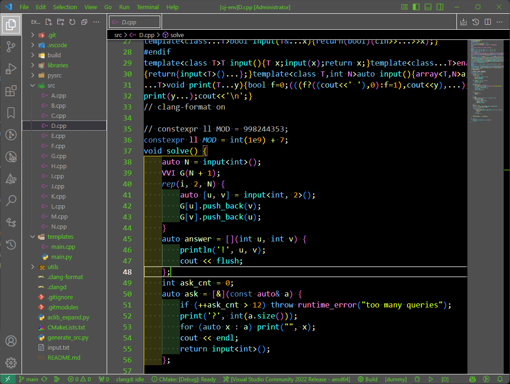

# LimeGray Theme

If VS Code's experimental [Modern UI](https://code.visualstudio.com/updates/v1_129#_modern-ui-preview-experimental) causes incorrect backgrounds or missing borders, you can disable it in your `settings.json`:

```json
{
  "workbench.experimental.modernUI": false
}
```

## Screenshots


